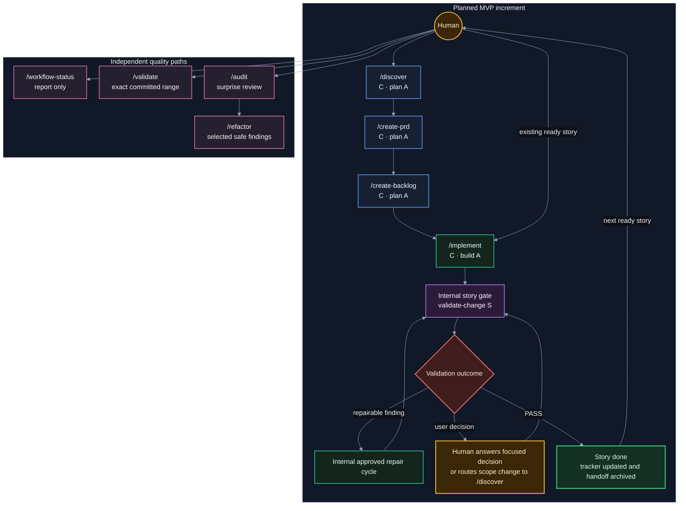
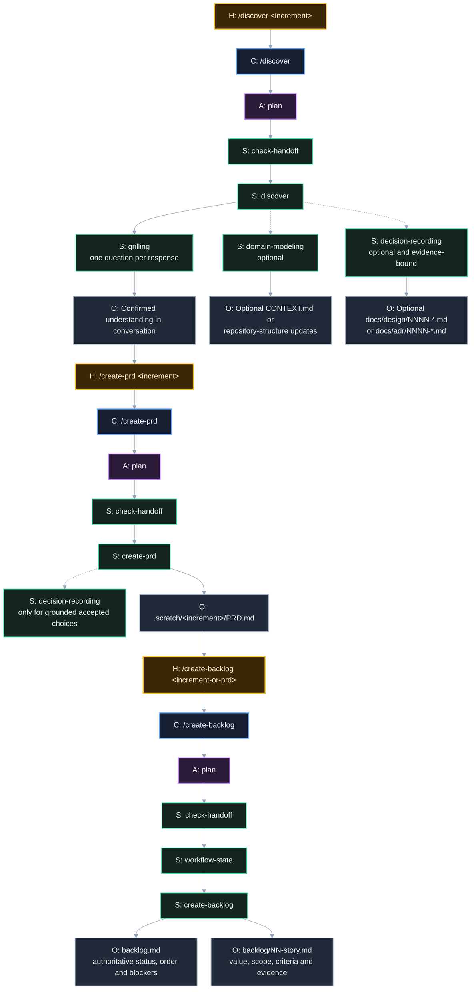
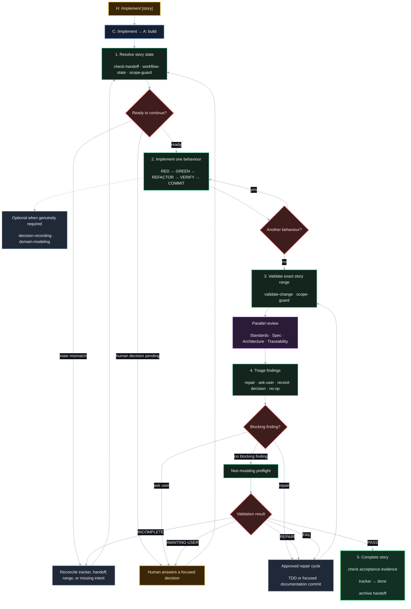
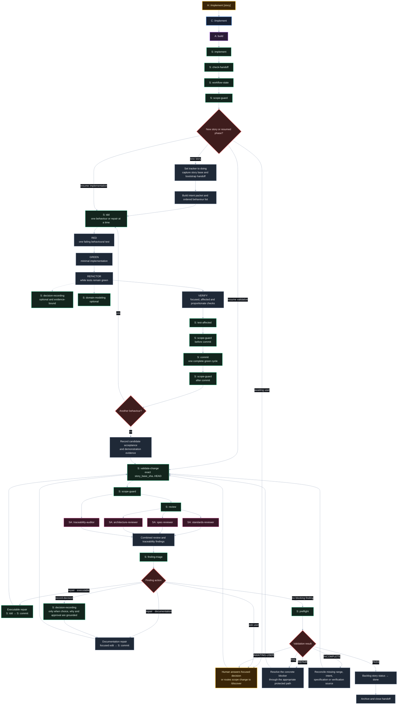
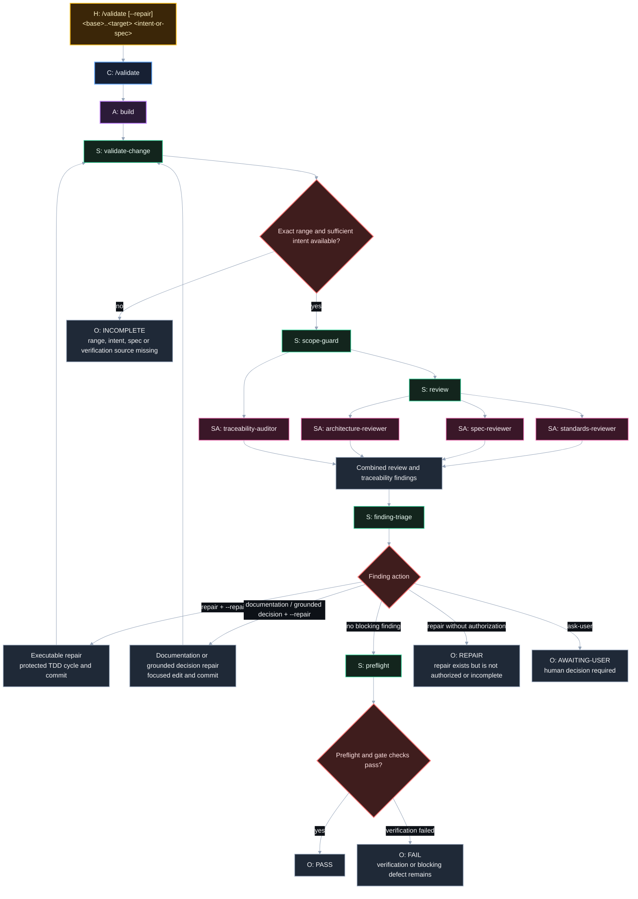
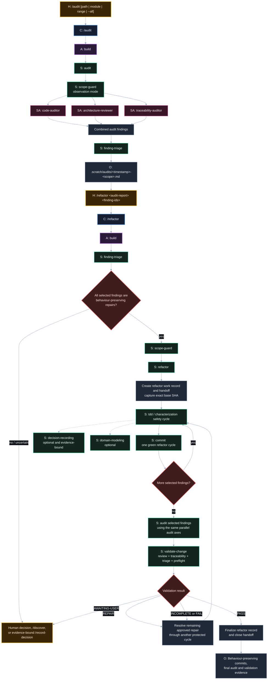

# Belling Cat

Belling Cat is a terminal-based fact-checking application developed with an OpenCode workflow built around conversational discovery, INVEST-oriented stories, test-driven development, durable handoff state, focused commits, and intent-aware validation.

This README is the **human guide** to the repository. It explains what to run, what OpenCode invokes internally, what artifacts are produced, and how to recover or validate work. The shorter [`AGENTS.md`](AGENTS.md) is the durable contract loaded by coding agents; detailed procedures live in `.opencode/skills/`.

## Project setup

Prerequisites:

- OpenCode
- Python 3.11 or newer
- [`uv`](https://docs.astral.sh/uv/)

Install the locked development environment:

```bash
uv sync --locked
```

Run the application:

```bash
uv run --locked python -m belling_cat
```

Run repository checks:

```bash
make test
make lint
make format-check
make typecheck
make workflow-lint
make preflight
```

`make preflight` is non-mutating. Style fixes are explicit:

```bash
make lint-fix PATHS="src tests"
make format PATHS="src tests"
```

## Agentic workflow quick start

Start OpenCode in the repository and use one conversational discovery session for one MVP increment:

```text
/discover belling-cat-mvp
/create-prd belling-cat-mvp
/create-backlog belling-cat-mvp
/implement
```

Run `/implement` again for each next ready story. At any point, run:

```text
/workflow-status
```

to see the active increment, story status, handoff phase, blockers, findings, and next valid action.

## How OpenCode pieces fit together

The workflow uses five distinct concepts. The labels below are used throughout this README.

| Label  | Concept           | What it is                                                            | Who invokes it                                                     |
| ------ | ----------------- | --------------------------------------------------------------------- | ------------------------------------------------------------------ |
| **H**  | Human             | A repository user making product and delivery decisions               | Types slash commands and answers questions                         |
| **C**  | Command           | A human-facing slash entry point under `.opencode/commands/`          | Invoked directly by **H**                                          |
| **A**  | Primary agent     | The `plan` or `build` agent selected by a command                     | Selected by **C**                                                  |
| **S**  | Skill             | A reusable procedure under `.opencode/skills/`                        | Loaded by **A** or another **S**                                   |
| **SA** | Internal subagent | A specialised read-only reviewer or auditor under `.opencode/agents/` | Invoked by the `build` **A** when a review/audit **S** requests it |

### Invocation rule

A slash command is the human entry point; internal workflows do **not** simulate typing other slash commands.

```text
H types /implement
  -> C /implement selects A build
      -> A build loads S implement
          -> S implement loads S tdd, S validate-change, and other supporting skills
              -> S review asks A build to invoke read-only SA reviewers
```

When this README says “`implement` invokes `validate-change`,” it means **skill-to-skill** invocation. It does not mean the agent types `/validate`.

### Repository layout

```text
.opencode/
├── commands/            # C: human-facing slash-command wrappers
├── skills/              # S: reusable workflow procedures
└── agents/              # SA: hidden read-only review/audit specialists

.scratch/                # Local workflow state; normally ignored by Git
├── <increment>/
│   ├── PRD.md
│   ├── backlog.md
│   ├── backlog/NN-*.md
│   └── handoffs/*.md
├── audits/*.md
├── refactors/*.md
└── handoff-context.md

docs/
├── 00-repo-structure.md # Durable module and dependency rules
├── design/*.md          # Reversible increment-level decisions
├── adr/*.md             # Significant architecture decisions
└── agent-workflow/*.md  # Workflow maintenance notes

CONTEXT.md               # Useful business language and ownership definitions
AGENTS.md                # Concise agent contract
README.md                # Human workflow guide
```

## Primary agents

Commands always select one of these primary agents.

| Primary agent | Selected for                                                                                 | Why it can edit and run shell commands                                   |
| ------------- | -------------------------------------------------------------------------------------------- | ------------------------------------------------------------------------ |
| `plan`        | Discovery, PRD, backlog, domain language, repository structure, design decisions, and ADRs   | Planning produces real repository artifacts rather than a chat-only plan |
| `build`       | Implementation, TDD, handoff, commits, review orchestration, audit, refactor, and validation | Delivery work changes code/tests/docs and runs repository checks         |

`plan` cannot invoke subagents. `build` may invoke only the five configured internal review/audit subagents.

## Human workflow overview



### The three common journeys

1. **Develop an MVP increment**  
   `/discover -> /create-prd -> /create-backlog -> /implement` for each story.

2. **Validate already committed work**  
   `/validate <base>..<target> <intent-or-spec>` when the work was created outside the normal story flow or needs an independent re-check.

3. **Run a surprise review**  
   `/audit [scope]`, triage its report, then `/refactor <report> <finding-ids>` for approved behaviour-preserving improvements.

## Detailed invocation trees (text flows)

These trees show the normal internal route. Optional skills run only when their concern is encountered.

### MVP planning

```text
H /discover <increment>
└── C /discover -> A plan
    ├── S check-handoff
    └── S discover
        ├── S grilling                         # one question per response
        ├── S domain-modeling     [optional]  # language/ownership becomes clearer
        └── S decision-recording  [optional]  # accepted design/architecture choice

Outputs:
- confirmed understanding in the conversation
- optional CONTEXT.md / docs/00-repo-structure.md updates
- optional docs/design/NNNN-<decision>.md and docs/adr/NNNN-*.md updates
- no mandatory discovery file

H /create-prd <increment>
└── C /create-prd -> A plan
    ├── S check-handoff
    └── S create-prd
        └── S decision-recording [when accepted technical rationale must move]

Output:
- .scratch/<increment>/PRD.md

H /create-backlog <increment-or-prd>
└── C /create-backlog -> A plan
    ├── S check-handoff
    ├── S workflow-state
    └── S create-backlog

Outputs:
- .scratch/<increment>/backlog.md              # authoritative story status/order/blockers
- .scratch/<increment>/backlog/NN-<story>.md   # story value/scope/criteria/evidence
```

### Story implementation and completion

```text
H /implement [story]
└── C /implement -> A build
    └── S implement
        ├── S check-handoff
        ├── S workflow-state
        ├── S scope-guard
        ├── handoff bootstrap/resume
        │
        ├── repeat one behaviour at a time
        │   └── S tdd
        │       ├── RED
        │       ├── GREEN
        │       ├── REFACTOR
        │       │   ├── S decision-recording [optional]
        │       │   └── S domain-modeling     [optional]
        │       ├── VERIFY
        │       │   └── S test-affected
        │       ├── S scope-guard
        │       └── S commit
        │
        └── S validate-change  # exact story_base_sha..HEAD
            ├── S scope-guard
            ├── S review
            │   ├── SA standards-reviewer
            │   ├── SA spec-reviewer
            │   └── SA architecture-reviewer
            ├── SA traceability-auditor
            ├── S finding-triage
            ├── repair loop [only approved in-intent repairs]
            │   ├── executable repair -> S tdd -> S commit
            │   └── approved rationale gap -> S decision-recording
            └── S preflight
                └── repository Makefile/CI, including workflow-lint

Outputs:
- production code, tests, and relevant durable documentation
- one green commit per completed TDD/repair cycle
- .scratch/handoff-context.md checkpoints during active work
- checked story acceptance/demo evidence after validation
- backlog tracker status changed to done only after PASS
- archived handoff under .scratch/<increment>/handoffs/
```

### Standalone validation

```text
H /validate [--repair] <base>..<target> <intent-or-spec>
└── C /validate -> A build
    └── S validate-change
        ├── S scope-guard
        ├── S review
        │   ├── SA standards-reviewer
        │   ├── SA spec-reviewer
        │   └── SA architecture-reviewer
        ├── SA traceability-auditor
        ├── S finding-triage
        ├── optional repair commits when --repair is authorized
        └── S preflight

Output:
- PASS, REPAIR, AWAITING-USER, INCOMPLETE, or FAIL
- evidence, findings, risk, checks, preserved baseline changes, and next action
- focused repair commits only when --repair is supplied
```

### Surprise audit and refactor

```text
H /audit [path|module|range|--all]
└── C /audit -> A build
    └── S audit
        ├── S scope-guard [observation mode]
        ├── SA code-auditor
        ├── SA architecture-reviewer
        ├── SA traceability-auditor
        └── S finding-triage

Output:
- .scratch/audits/<timestamp>-<scope>.md

H /refactor <audit-report> <finding-ids>
└── C /refactor -> A build
    ├── S finding-triage
    ├── S scope-guard
    └── S refactor
        ├── characterization/TDD safety cycles
        ├── S decision-recording [optional]
        ├── S domain-modeling     [optional]
        ├── repeat S audit against selected findings
        └── S validate-change
            ├── review subagents
            ├── traceability-auditor
            └── S preflight

Outputs:
- .scratch/refactors/<timestamp>-<slug>.md
- behaviour-preserving green commits
- updated durable decisions/language only when genuinely required
- final audit and validation evidence
```

---

## Detailed invocation trees (mermaid)

### MVP planning



---

### Story implementation and completion (simple)



---

### Story implementation and completion (detailed)



---

### Standalone validation



---

### Surprise audit and refactor



---

## Main human workflow

### 1. Discover one increment

```text
/discover <increment-name-or-intent>
```

The `plan` agent inspects the repository and asks exactly one high-value question per response. One discovery interaction normally defines one MVP increment and may identify several stories.

Discovery separates information by owner:

```text
product behaviour/constraints       -> future PRD
business language/responsibility    -> CONTEXT.md
module/dependency rules             -> docs/00-repo-structure.md
local reversible technical choices  -> docs/design/NNNN-<decision>.md
significant architecture trade-offs -> docs/adr/NNNN-*.md
unresolved alternatives             -> open decisions, not fake accepted choices
```

There is no dedicated discovery-state file. After you approve the final shared-understanding summary, run `/create-prd` in the same OpenCode conversation. If the original conversation is no longer available and important intent cannot be reconstructed safely, resume discovery rather than asking the agent to infer product intent from code.

### 2. Create the PRD

```text
/create-prd <increment-name>
```

Creates:

```text
.scratch/<increment>/PRD.md
```

The PRD owns observable product outcomes, behaviours, constraints, quality attributes, exclusions, and acceptance/demo evidence. It references design decisions and ADRs rather than duplicating their full rationale.

### 3. Create and review the backlog

```text
/create-backlog <increment-name-or-prd-path>
```

Creates:

```text
.scratch/<increment>/backlog.md
.scratch/<increment>/backlog/NN-<story>.md
```

Review the proposed story value, scope, size, ordering, blockers, and demonstration evidence before implementation.

Stories use INVEST as a heuristic:

- reasonably independent;
- negotiable rather than over-specified;
- valuable to a user, stakeholder, operator, or delivery team;
- estimable enough to reason about scope;
- small enough to complete safely;
- testable with observable evidence.

A strict vertical slice is not mandatory. A technical enabler is acceptable when it unlocks, de-risks, or proves a meaningful capability and has demonstrable acceptance evidence.

### 4. Implement one story

```text
/implement [ITEM-NN-or-story-path]
```

The `build` agent reads the backlog tracker and active handoff together. It resumes the exact phase when they agree or reconciles state before changing production code.

Every behaviour or approved executable repair follows:

```text
RED -> GREEN -> REFACTOR -> VERIFY -> COMMIT
```

Each completed green cycle receives a focused commit, for example:

```text
ITEM-04 Cycle 01: classify supported evidence
ITEM-04 Cycle 02: surface conflicting sources
```

Story completion includes intent-aware review, traceability review, repairs that are clearly inside approved intent, and non-mutating preflight. Product, contract, dependency, material architecture, and risk-acceptance choices return to the human.

### 5. Check or recover state

```text
/workflow-status [increment]
```

This is report-only. It shows:

- increment and backlog availability;
- counts by `to-do`, `doing`, and `done`;
- active or next ready story;
- tracker/handoff consistency;
- story base SHA and current HEAD;
- exact cycle and phase;
- preserved unrelated workspace changes;
- open findings and required decisions;
- validation/preflight state;
- next valid command.

Run:

```text
/handoff reconcile
```

when the tracker and handoff disagree, a `doing` story has no handoff, the recorded review range appears wrong, or Git history and recorded cycle state conflict. Reconciliation inspects evidence; it does not guess or modify product code.

## Validation and finding outcomes

`validate-change` returns exactly one outcome:

| Outcome         | Meaning                                                                  | Typical next action                                      |
| --------------- | ------------------------------------------------------------------------ | -------------------------------------------------------- |
| `PASS`          | Intent, review, traceability, and preflight gates passed                 | Complete/archive the story or accept the committed range |
| `REPAIR`        | In-scope repairs remain but were not authorized or completed             | Run `/validate --repair` or return to `/implement`       |
| `AWAITING-USER` | At least one decision belongs to the human                               | Answer the focused decision, then resume validation      |
| `INCOMPLETE`    | Reliable range, intent, specification, or verification source is missing | Reconcile state or provide the missing source            |
| `FAIL`          | Verification failed or a blocking defect remains                         | Fix the concrete blocker and re-run validation           |

Every finding is independently assigned one action:

- `repair` — clearly within approved intent;
- `ask-user` — changes behaviour, scope, contract, dependency, material architecture, or risk acceptance;
- `record-decision` — an already accepted rationale is missing or stale;
- `no-op` — accepted trade-off or observation requiring no change.

Agents should report concrete remaining decisions, repairs, checks, and blockers. They should not provide time or effort estimates unless the human explicitly requests an estimate.

## Surprise review and refactoring

Run a read-only audit at any time:

```text
/audit [path|module|range|--all]
```

The report is written under `.scratch/audits/` and separates:

- behaviour-preserving repairs eligible for `/refactor`;
- missing accepted rationale eligible for `/record-decision`;
- product/material architecture choices requiring the human or `/discover`;
- observations requiring no action.

Resolve selected safe findings with:

```text
/refactor <audit-report> <finding-ids>
```

`/refactor` is not a back door for new behaviour. If a finding changes observable behaviour, contracts, data semantics, dependencies, scope, or material architecture, return to discovery or ask the human directly.

## Validate already committed work

Use standalone validation for committed work created outside the normal story lifecycle or for an independent re-check:

```text
/validate <base-sha>..<target-sha> <intent-or-spec-path>
/validate --repair <base-sha>..<target-sha> <intent-or-spec-path>
```

The range and intent are mandatory when no active story handoff exists. The validator never guesses `main`, `HEAD~1`, or a branch name as the fixed point.

Default validation is read-only. `--repair` authorizes only findings already classified as clearly inside supplied intent. Validation does not push, rebase, open a PR, merge, or rewrite history.

## State and artifacts

### Source-of-truth rules

| Artifact                               | Authoritative for                                                              | Git status                      |
| -------------------------------------- | ------------------------------------------------------------------------------ | ------------------------------- |
| `CONTEXT.md`                           | Useful business language and responsibility definitions                        | Durable; commit it              |
| `docs/00-repo-structure.md`            | Current module ownership and dependency direction                              | Durable; commit it              |
| `docs/design/NNNN-<decision>.md`       | Reversible increment-specific technical rationale                              | Durable; commit it              |
| `docs/adr/NNNN-*.md`                   | Cross-cutting, long-lived, costly, or surprising architecture trade-offs       | Durable; commit it              |
| `.scratch/<increment>/PRD.md`          | Product outcome, behaviour, constraints, exclusions, and acceptance evidence   | Local workflow state by default |
| `.scratch/<increment>/backlog.md`      | Story order, lifecycle status, and blockers                                    | Local workflow state by default |
| `.scratch/<increment>/backlog/NN-*.md` | Story intent, value, scope, criteria, demo/test evidence, and references       | Local workflow state by default |
| `.scratch/handoff-context.md`          | Active execution state, exact range, cycle, evidence, findings, and validation | Local recovery state            |
| `Makefile` or CI config                | Executable verification commands                                               | Durable; commit it              |

Use one primary owner per durable fact. Other artifacts link to that owner instead of copying full rationale or mutable state.

### Story lifecycle

The backlog tracker is authoritative:

```text
to-do -> doing -> done
```

Only one story may be `doing`. A story file does not own mutable status. A story becomes `done` only after its acceptance/demo evidence is verified and validation returns `PASS`.

### Tracker and handoff

The tracker answers:

> Which story is active, in what order, and with which blockers?

The handoff answers:

> Exactly where did execution stop, against which commit range, with what evidence and findings?

`/implement` and `/workflow-status` always read both.

## Internal subagents

The table distinguishes the **direct caller skill** from the **human commands that reach that skill**.

| Internal subagent **SA** | Direct caller skill **S**  | Reached through human commands **C**                        | Responsibility                                                                                                    | May write? |
| ------------------------ | -------------------------- | ----------------------------------------------------------- | ----------------------------------------------------------------------------------------------------------------- | ---------- |
| `standards-reviewer`     | `review`                   | `/review`, `/validate`, `/implement`, `/refactor`           | Documented coding, repository, and contribution standards not already owned by tools                              | No         |
| `spec-reviewer`          | `review`                   | `/review`, `/validate`, `/implement`, `/refactor`           | User intent, PRD, story, acceptance/demo evidence, scope, and accepted decisions                                  | No         |
| `architecture-reviewer`  | `review`, `audit`          | `/review`, `/validate`, `/implement`, `/audit`, `/refactor` | Proportionate boundaries, dependency direction, ownership, and decision compliance                                | No         |
| `code-auditor`           | `audit`                    | `/audit`, `/refactor`                                       | Correctness, security, resilience, performance hazards, maintainability, cohesion, and error handling             | No         |
| `traceability-auditor`   | `audit`, `validate-change` | `/audit`, `/validate`, `/implement`, `/refactor`            | Undocumented decisions, stale artifacts, intent drift, mutable-state duplication, and weak behavioural protection | No         |

All five subagents are hidden from normal `@` autocomplete and explicitly denied editing, arbitrary shell commands, nested tasks, skill loading, direct user questions, external-directory access, and web access. `hidden` affects discoverability; explicit permissions and the `build` task allowlist provide the actual boundary.

## Skills and their normal callers

This table uses separate columns for command callers and skill callers. A blank skill-caller cell means the skill is normally entered through its slash-command wrapper rather than composed by another skill.

| Skill **S**          | Direct command wrapper(s) **C**               | Direct/normal skill caller(s) **S**                                                                       | Responsibility and principal output                                                                                |
| -------------------- | --------------------------------------------- | --------------------------------------------------------------------------------------------------------- | ------------------------------------------------------------------------------------------------------------------ |
| `audit`              | `/audit`                                      | `refactor` reruns the audit procedure                                                                     | Read-only multi-axis audit; writes `.scratch/audits/*.md`                                                          |
| `check-handoff`      | `/discover`, `/create-prd`, `/create-backlog` | `discover`, `implement`                                                                                   | Detect active/incompatible work before another workflow begins                                                     |
| `commit`             | `/commit`                                     | `tdd`; focused validation documentation repairs                                                           | Stage explicit files and commit one verified green/documentation cycle                                             |
| `create-backlog`     | `/create-backlog`                             | —                                                                                                         | Create the authoritative tracker and INVEST-oriented story files                                                   |
| `create-prd`         | `/create-prd`                                 | —                                                                                                         | Synthesize confirmed discovery into `.scratch/<increment>/PRD.md`                                                  |
| `decision-recording` | `/record-decision`                            | `discover`, `grilling`, `create-prd`, `implement`, `tdd`, `finding-triage`, `refactor`, `validate-change` | Route accepted choices to PRD, design record, ADR, repo structure, open decision, or no record                     |
| `discover`           | `/discover`                                   | —                                                                                                         | One-increment questioning, repository inspection, decision/language capture, and shared-understanding confirmation |
| `domain-modeling`    | `/domain-modeling`                            | `discover`, `grilling`, `implement`, `tdd`, `refactor`                                                    | Improve useful language, responsibility ownership, and module boundaries without DDD ceremony                      |
| `finding-triage`     | `/review`, `/audit`, `/refactor`              | `review`, `audit`, `refactor`, `validate-change`                                                          | Assign severity and `repair`, `ask-user`, `record-decision`, or `no-op` ownership                                  |
| `grilling`           | `/grilling`                                   | `discover`                                                                                                | Ask exactly one Socratic question with current understanding and a recommended default                             |
| `handoff`            | `/handoff`                                    | Implementation, TDD, validation, and refactor workflows maintain its contract/state                       | Bootstrap, checkpoint, reconcile, close, or discard `.scratch/handoff-context.md`                                  |
| `implement`          | `/implement`                                  | —                                                                                                         | Orchestrate one story from tracker/handoff resolution through TDD, validation, preflight, and completion           |
| `lint`               | `/lint`                                       | —                                                                                                         | Non-mutating check by default; scoped fix only with `--fix`                                                        |
| `preflight`          | `/preflight`                                  | `validate-change`                                                                                         | Run the repository-owned non-mutating CI-equivalent gate                                                           |
| `refactor`           | `/refactor`                                   | —                                                                                                         | Resolve selected behaviour-preserving audit findings with protected green commits                                  |
| `review`             | `/review`                                     | `validate-change`                                                                                         | Invoke Standards, Spec, and Architecture subagents against an exact committed range                                |
| `scope-guard`        | `/commit`, `/refactor`                        | `workflow-state`, `implement`, `tdd`, `audit`, `refactor`, `lint`, `validate-change`                      | Capture baseline and prevent unrelated changes from entering the active scope                                      |
| `tdd`                | `/tdd`                                        | `implement`, `refactor`, validation repair loops                                                          | Execute one RED-GREEN-REFACTOR-VERIFY-COMMIT behaviour/safety cycle                                                |
| `test-affected`      | `/test-affected`                              | `tdd` VERIFY phase                                                                                        | Select and run proportionate affected tests without assuming repository-specific scripts                           |
| `validate-change`    | `/validate`                                   | `implement`, `refactor`                                                                                   | Gate an active story or exact committed range against intent, review, traceability, and preflight                  |
| `workflow-lint`      | `/workflow-lint`                              | `preflight` through the Makefile/CI gate                                                                  | Check commands, skills, agents, references, permissions, templates, docs, and tooling for drift                    |
| `workflow-state`     | `/workflow-status`, `/create-backlog`         | `create-backlog`, `implement`                                                                             | Reconcile tracker, handoff, Git, blockers, intent, and the next valid action                                       |

Skills are reusable instructions, not human-facing APIs. Humans should normally invoke the corresponding slash command rather than asking OpenCode to load a skill directly.

## Commands and who normally triggers them

### Normal human entry points

All commands in this table are typed directly by the human. The table therefore focuses on purpose, traceability, and outputs rather than repeating a “triggered by human” column.

| Command **C**      | Primary agent **A** | When and why to use it                                                                                                    | Skills used **S**                                                                                                                                                                              | Internal subagents **SA**                                                              | Principal outputs                                                                            |
| ------------------ | ------------------- | ------------------------------------------------------------------------------------------------------------------------- | ---------------------------------------------------------------------------------------------------------------------------------------------------------------------------------------------- | -------------------------------------------------------------------------------------- | -------------------------------------------------------------------------------------------- |
| `/discover`        | `plan`              | Start every behaviour-changing increment; align requirements, constraints, language, and decisions one question at a time | `check-handoff`, `discover`, then `grilling`; optional `domain-modeling`, `decision-recording`                                                                                                 | None                                                                                   | Confirmed conversation; optional context, structure, design, and ADR updates                 |
| `/create-prd`      | `plan`              | After discovery understanding is explicitly confirmed                                                                     | `check-handoff`, `create-prd`; optional `decision-recording`                                                                                                                                   | None                                                                                   | `.scratch/<increment>/PRD.md` and decision references                                        |
| `/create-backlog`  | `plan`              | After reviewing the PRD; create ordered stories and blockers                                                              | `check-handoff`, `workflow-state`, `create-backlog`                                                                                                                                            | None                                                                                   | Tracker plus story files under `.scratch/<increment>/`                                       |
| `/implement`       | `build`             | Start or resume exactly one ready story and carry it through completion                                                   | `implement`, `check-handoff`, `workflow-state`, `scope-guard`, `tdd`, `test-affected`, `commit`, optional decision/language skills, `validate-change`, `review`, `finding-triage`, `preflight` | `standards-reviewer`, `spec-reviewer`, `architecture-reviewer`, `traceability-auditor` | Code/tests/docs, cycle commits, active/archived handoff, acceptance evidence, tracker update |
| `/workflow-status` | `plan`              | Inspect progress, mismatches, blockers, findings, and next action without modifying files                                 | `workflow-state` in report mode                                                                                                                                                                | None                                                                                   | Conversation report only                                                                     |
| `/audit`           | `build`             | Run an unplanned/surprise quality review of a path, module, range, or repository                                          | `audit`, `scope-guard` observation, `finding-triage`                                                                                                                                           | `code-auditor`, `architecture-reviewer`, `traceability-auditor`                        | `.scratch/audits/<timestamp>-<scope>.md`                                                     |
| `/refactor`        | `build`             | Resolve selected audit findings that are confirmed behaviour-preserving                                                   | `finding-triage`, `scope-guard`, `refactor`, TDD/safety procedures, optional decision/language skills, `audit`, `validate-change`, `preflight`                                                 | Audit subagents, then validation reviewers/auditor                                     | Refactor work record, green commits, final audit/validation evidence                         |
| `/validate`        | `build`             | Validate committed work outside `/implement`, or independently re-check a known range                                     | `validate-change`, `scope-guard`, `review`, `finding-triage`, `preflight`; optional repair/decision procedures                                                                                 | `standards-reviewer`, `spec-reviewer`, `architecture-reviewer`, `traceability-auditor` | Validation outcome, findings/evidence; optional focused repair commits with `--repair`       |

### Advanced or diagnostic commands

These commands are also typed directly by a human when needed. The “normal internal route” column explains which skill usually performs the same responsibility during a larger workflow; it does **not** mean that a skill invokes the slash command.

| Command **C**      | Primary agent **A** | Direct human use                                                                       | Normal internal route                                                                                                | Principal output                                                                |
| ------------------ | ------------------- | -------------------------------------------------------------------------------------- | -------------------------------------------------------------------------------------------------------------------- | ------------------------------------------------------------------------------- |
| `/grilling`        | `plan`              | Manually ask the next single discovery question or test the interviewing behaviour     | `discover` **S** loads `grilling` **S**                                                                              | One question plus current understanding/default recommendation                  |
| `/record-decision` | `plan`              | Extract decisions from an old PRD/audit or record one accepted choice explicitly       | `decision-recording` **S** is loaded by discovery, PRD, implementation, triage, refactor, and validation flows       | PRD update, `docs/design/*`, ADR, repo structure, or an open-decision record    |
| `/domain-modeling` | `plan`              | Clarify confusing terms, responsibility, lifecycle, or module ownership                | `domain-modeling` **S** is loaded when discovery/implementation/refactor uncovers a real language or ownership issue | `CONTEXT.md`, optional `CONTEXT-MAP.md`, or `docs/00-repo-structure.md` updates |
| `/handoff`         | `build`             | Inspect, checkpoint, reconcile, close, or explicitly discard recovery state            | Implementation/refactor/TDD workflows maintain the handoff contract as they progress                                 | Handoff status/update/archive; no product-code change for status/reconcile      |
| `/tdd`             | `build`             | Run one explicitly named behaviour or repair cycle manually                            | `implement` and `refactor` **S** use the `tdd` **S** procedure                                                       | Test/code change, verification evidence, one green commit, handoff checkpoints  |
| `/review`          | `build`             | Read-only review of a supplied exact range/specification                               | `validate-change` **S** loads `review` **S**                                                                         | Standards/Spec/Architecture findings; no repairs                                |
| `/commit`          | `build`             | Commit one already verified scoped cycle or documentation repair                       | `tdd` **S** loads `commit` **S**                                                                                     | One focused commit; unrelated baseline preserved                                |
| `/test-affected`   | `build`             | Diagnose or run tests affected by paths or a fixed commit                              | `tdd` VERIFY uses the `test-affected` procedure                                                                      | Selected tests, rationale, pass/fail counts, failing names                      |
| `/lint`            | `build`             | Check style/format, or explicitly fix only supplied paths with `--fix`                 | Preflight uses non-mutating Makefile checks; it does not invoke auto-fix                                             | Check report or scoped formatting/lint edits                                    |
| `/preflight`       | `build`             | Run the final repository-owned CI-equivalent gate manually                             | `validate-change` **S** loads `preflight` **S**                                                                      | Per-check exit status, concise failures, and workspace-mutation check           |
| `/workflow-lint`   | `build`             | Verify workflow artifacts after changing `.opencode/`, docs, permissions, or templates | `make preflight` includes the workflow validator                                                                     | Workflow errors/warnings and counts                                             |

## Development and workflow maintenance

The Makefile owns executable verification commands. Agent skills should refer to this owner rather than duplicating command recipes.

```bash
make test
make lint
make format-check
make typecheck
make workflow-lint
make preflight
```

All verification targets use the committed `uv.lock` and check modes. `make preflight` must leave tracked files unchanged.

When changing `.opencode/`, `AGENTS.md`, `README.md`, `opencode.json`, workflow templates, or `scripts/validate_agent_workflow.py`, run:

```bash
make workflow-lint
```

Supporting migration, harvest, and audit notes live under `docs/agent-workflow/`.
